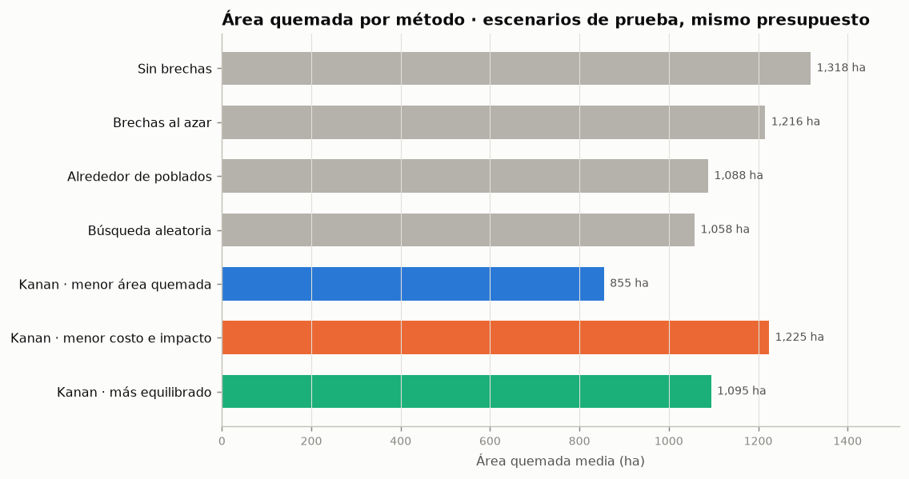
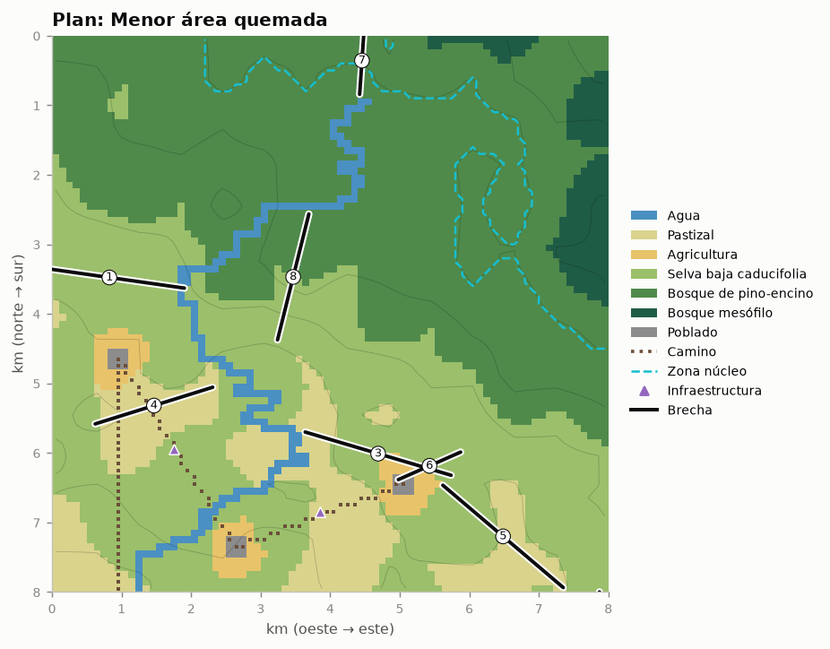
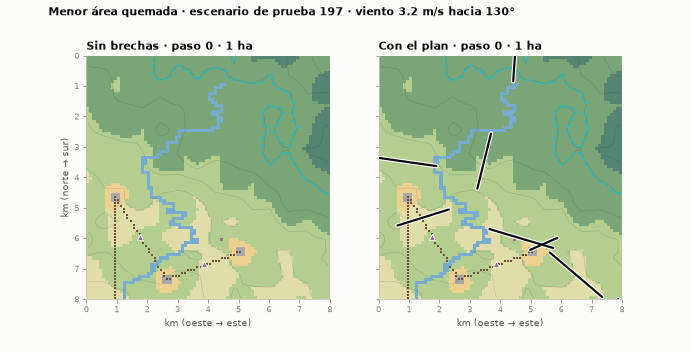

# Kanan

Kanan decide dónde construir brechas cortafuego en una zona forestal con un presupuesto
limitado. Usa un algoritmo genético multiobjetivo (NSGA-II) que califica cada plan simulando
cientos de incendios con un autómata celular. El caso de estudio es la Reserva de la Biosfera
La Sepultura, Chiapas.

*Kanan* significa "cuidar, proteger, vigilar" en tseltal.

> Prototipo de apoyo a la decisión sobre un **mapa sintético**. El modelo de fuego es una
> simplificación: los resultados no son una recomendación operativa.

El planteamiento completo está en [`docs/brief.md`](docs/brief.md).

## Resultado de la corrida por omisión

Mismo presupuesto para todos los métodos, medidos en 500 incendios que el algoritmo nunca
vio (100 individuos × 200 generaciones × 300 escenarios de entrenamiento, 27 s de
optimización):

| Método | Área quemada media | Reducción | Costo |
| --- | ---: | ---: | ---: |
| Sin brechas | 1 318 ha | — | 0 |
| Brechas al azar (30 planes) | 1 216 ha | 7.7 % | 349 878 |
| Alrededor de poblados | 1 088 ha | 17.4 % | 347 777 |
| Búsqueda aleatoria (mismas evaluaciones) | 1 058 ha | 19.7 % | 349 259 |
| **Kanan · menor área quemada** | **855 ha** | **35.1 %** | 350 000 |
| Kanan · más equilibrado | 1 095 ha | 16.9 % | 125 671 |
| Kanan · menor costo e impacto | 1 225 ha | 7.1 % | 53 823 |

El plan más barato de Kanan logra con 15 % del presupuesto lo mismo que las brechas al azar
con todo.



| Plan de menor área quemada | El mismo incendio sin y con el plan |
| --- | --- |
|  |  |

## Instalación

Requiere Python 3.11 o posterior.

```bash
python3 -m venv .venv
```

```bash
.venv/bin/pip install -e ".[dev]"
```

## Uso

### Aplicación interactiva

La forma principal de usar Kanan. Abre el navegador, deja ajustar los parámetros, corre el
algoritmo y permite explorar el resultado sin generar archivos:

```bash
.venv/bin/kanan app
```

- **Resultado:** comparación con los métodos de referencia en incendios nuevos.
- **Explorar planes:** haz clic en cualquier plan del frente de Pareto para verlo en el mapa,
  con sus objetivos, y reproduce un incendio completo (o recórrelo paso a paso) sin y con
  sus brechas.
- **Evolución:** objetivos e hipervolumen por generación.
- **Zona de estudio:** el mapa sintético y la zona real en Google Maps.
- **Datos:** descarga de las tablas en CSV.

### Línea de comandos

Corrida completa (cerca de un minuto; la primera vez compila el simulador). Imprime la
comparación y guarda solo las tablas de datos:

```bash
.venv/bin/kanan ejecutar --salida resultados/completa
```

Corrida corta para probar que todo funciona:

```bash
.venv/bin/kanan ejecutar --config configs/rapido.yaml --salida resultados/rapido
```

El reporte HTML con figuras y animaciones se genera solo si se pide:

```bash
.venv/bin/kanan ejecutar --salida resultados/completa --reporte
```

Solo dibujar el área de estudio:

```bash
.venv/bin/kanan mapa --salida resultados/mapa
```

Las entradas (presupuesto, K,
longitudes, viento, escenarios, parámetros del AG, semillas) se cambian en un YAML como
[`configs/default.yaml`](configs/default.yaml); las claves que falten conservan su valor por
omisión.

### Qué produce `kanan ejecutar`

Siempre: `comparacion.csv`, `planes_brechas.csv`, `frente_pareto.csv`, `resumen.json`,
`historial.npz` y `config_usada.yaml`. Con `--reporte`, además:

| Archivo | Contenido |
| --- | --- |
| `reporte.html` | Todo reunido, listo para presentar |
| `comparacion.png`, `cajas.png`, `comparacion.csv` | Kanan contra los métodos de referencia |
| `evolucion.png`, `hipervolumen.png`, `pareto.png` | Evolución del algoritmo y frente de Pareto |
| `plan_<clave>_mapa.png` | Mapa con las brechas de cada uno de los tres planes |
| `plan_<clave>_probabilidad.png` | Probabilidad de quema sin y con el plan |
| `plan_<clave>_incendio.gif` | Animación del mismo incendio sin y con el plan |

## Cómo funciona

1. **Mapa.** Cuadrícula de 80 × 80 celdas de 100 m con vegetación, densidad, elevación,
   poblados, cultivos, caminos, zona núcleo y riesgo de ignición.
2. **Plan.** Un cromosoma de 32 números: 8 brechas × (x, y, ángulo, longitud). Cada brecha se
   traza como una línea de celdas sin combustible; si el plan excede el presupuesto, sus
   longitudes se acortan en proporción.
3. **Simulación.** Autómata celular de Alexandridis et al. (2008): una celda en llamas
   enciende a cada vecina con probabilidad `p_h (1 + p_veg)(1 + p_den) p_w p_s`.
4. **Aptitud.** Cuatro objetivos a minimizar: área quemada, valor afectado, costo e impacto
   ecológico.
5. **NSGA-II.** Torneo binario, intercambio de brechas completas más SBX, mutación polinomial
   y elitismo por frentes.
6. **Validación.** Los planes elegidos se comparan con cuatro métodos simples en escenarios
   nuevos.

## Estructura

```
src/kanan/
  config.py        Entradas del usuario (YAML → dataclasses)
  dominio/         Base de conocimiento: catálogos, mapa, plan de brechas
  simulacion/      Autómata celular y escenarios
  optimizacion/    Aptitud, NSGA-II, hipervolumen, selección de planes
  validacion/      Métodos de referencia y comparación
  salidas/         Figuras, animación, tablas, reporte
  aplicacion/      Caso de uso que orquesta una corrida
  interfaz/        Aplicación interactiva (Streamlit)
  cli.py           Línea de comandos
video/             Video explicativo generado por código y su guion
tests/             Pruebas (incluye las de cordura del simulador)
configs/           Configuraciones de ejemplo
docs/              Brief, planes, decisiones y bitácora
```

Las dependencias van en un solo sentido, de `cli` hacia `dominio`
([ADR 002](docs/decisiones/002-arquitectura-por-capas.md)).

## Video explicativo

Un video de 7 minutos explica cómo funciona Kanan por dentro. Se genera con
`.venv/bin/python -m video.generar`; las instrucciones para agregarle narración están en
[`video/README.md`](video/README.md).

## Desarrollo

```bash
.venv/bin/pytest
```

```bash
.venv/bin/ruff check .
```

- Forma de trabajo (gitflow, commits): [`CONTRIBUTING.md`](CONTRIBUTING.md)
- Justificación del stack tecnológico y alternativas: [`docs/stack-tecnologico.md`](docs/stack-tecnologico.md)
- Planes por fase: [`docs/planes`](docs/planes/00-plan-maestro.md)
- Decisiones y sus razones: [`docs/decisiones`](docs/decisiones/README.md)
- Lo realizado: [`docs/bitacora.md`](docs/bitacora.md) y [`CHANGELOG.md`](CHANGELOG.md)

## Límites conocidos

- El mapa es sintético; el de INEGI queda como trabajo futuro.
- Los parámetros por tipo de vegetación, los costos y los valores ecológicos son supuestos.
- Un paso del autómata no está calibrado contra tiempo real.
- Una brecha de 10 m se modela como una celda completa de 100 m sin combustible.
